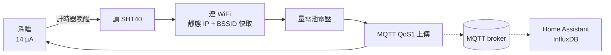

<h1 align="center">EnviroSense</h1>

<p align="center">以 Seeed XIAO ESP32C6、單顆 21700 鋰電池與 MQTT 打造的低功耗環境溫濕度感測節點</p>

<p align="center">
  
  
  
</p>

<!-- 封面：docs/images/cover.png，放載板 PCB 3D 渲染（尚無圖，之後補上） -->

<p align="center">
  <a href="#-特色">特色</a> ·
  <a href="#-快速開始">快速開始</a> ·
  <a href="#-硬體">硬體</a> ·
  <a href="#-文件">文件</a>
</p>

## ✨ 特色

- **一顆電池跑一年以上**：醒來才量測、量完立刻深睡。5 分鐘上傳一次，5000 mAh 的 21700 估計可撐 **約 16 個月**（見[續航估算](#續航估算)）
- **量完馬上上傳**：每次喚醒讀 SHT40（±0.2 °C / ±1.8 %RH），經 MQTT 送到 broker；沒有批次緩衝，資料時間就是 broker 收到的時間
- **接上 Home Assistant 就能用**：MQTT 自動探索，溫度、濕度、電池電壓、訊號強度自動出現；節點離線由 HA 的 `expire_after` 判斷
- **斷線不掉資料**：每筆有遞增序號，WiFi 失敗時存下來、下次補送，並指數退避；絕不自己開設定頁耗電
- **不用裝開發環境**：下載燒錄包，或直接用[網頁燒錄](https://hodzadkiel.github.io/EnviroSense/)，只需要知道裝置的 COM port

> [!IMPORTANT]
> 這個韌體是為 **EnviroSense 載板**設計的（SHT40、電池電壓分壓閘控、電池保護電路）。
> 只燒在單獨的 XIAO ESP32C6 上無法正常量測。載板的 Gerber、BOM 與設計檔在 [`hardware/`](./hardware/)。

### 運作方式



耗電幾乎都花在喚醒視窗：依功耗模型，**上傳佔總耗電的 76 %**（5 分鐘模式），深睡只佔 4 %。
所以設計的重點是把視窗縮短 —— 已上線節點實測 `uptime_ms` 中位數 **523 ms**，加上 MQTT 收尾約 0.8 秒。

### 規格

| 項目 | 內容 |
|---|---|
| MCU | Seeed XIAO ESP32C6（深睡 14.3 µA、板載充電 120 mA、u.FL 外接天線） |
| 感測器 | Nyfea SHT40-N-NF（I²C 0x44，量測 6.9 ms） |
| 電池 | 21700 鋰電池（載板座位 BH-21700-B1BJ001），截止電壓 3.3 V |
| 上傳間隔 | 1 / 5 / 15 / 30 分鐘，設定頁選擇 |
| 通訊 | WiFi + MQTT（不開 TLS、QoS 1），Home Assistant 探索 |
| 電池量測 | 2 MΩ / 2 MΩ 分壓 + 2N7002 閘控（不量時漏電趨近 0） |
| 保護 | DW01A + 8205A（過放 / 過流），韌體四段式低電量處理 |

### 續航估算

用已上線節點的實測喚醒視窗（平均 824 ms）代入功耗模型，5000 mAh、可用 80 %：

| 上傳間隔 | 每日耗電 | 預估續航 |
|---|---|---|
| 5 分鐘 | 5.4 mAh | **約 16.7 個月** |
| 15 分鐘 | 2.1 mAh | 約 28.9 個月 |
| 30 分鐘 | 1.3 mAh | 約 35.4 個月 |

> [!NOTE]
> 這是**模型估算**：視窗長度來自實測，但喚醒時的平均電流（75.8 mA）仍是估計值，
> 還沒用 PPK2 量過。實際續航要靠長期放電曲線驗證，見 [功耗預算](./docs/power-budget.md)。

## 🚀 快速開始

你需要：一塊 EnviroSense 載板（已裝 XIAO ESP32C6、電池座與電芯）、一條可傳資料的 USB 線。

**1. 讓晶片進燒錄模式**：按住 `BOOT` → 按一下 `RESET` → 放開 `BOOT`（節點平常在深睡，USB 序列埠不會出現）

**2. 燒錄韌體**，二選一：

- **網頁燒錄**（桌面版 Chrome / Edge）：<https://hodzadkiel.github.io/EnviroSense/>
- **燒錄包**：到 [Releases](https://github.com/HoDZadkiel/EnviroSense/releases) 下載 `*-flasher.zip`，解壓縮後

  ```bat
  flash.bat COM5
  ```

  Linux / macOS：`bash flash.sh /dev/ttyACM0`（需先 `pip install esptool`）。詳見 [燒錄說明](./firmware/release/0.2.2-ha/README.md)

> [!WARNING]
> 「全新安裝」會清掉整顆 flash，包含已存的 WiFi / MQTT 設定。只想換韌體、保留設定，選 **update**。

**3. 設定**：按一次 `RESET`，LED 亮後 10 秒內再按一次 `RESET` → 節點開出 WiFi `EnviroSense-<MAC 後 6 碼>`，
手機連上後會自動跳出設定頁：選 WiFi、填 broker、選上傳間隔與 IP 策略。180 秒沒存檔會自動關閉回去睡。

**4. 看資料**：訂閱 `envirosense/<node_id>/state`，或在 Home Assistant 的 MQTT 整合裡找到新裝置。
Mosquitto 與 HA 的設定範例在 [`deploy/`](./deploy/)，payload 格式見 [MQTT 協定](./docs/mqtt-protocol.md)。

```json
{"id":"a1b2c3","seq":1234,"t":24.31,"h":58.2,"vbat":3.92,"rssi":-58,"up":523,"flags":[]}
```

## 🔌 硬體

載板很小：XIAO 直接焊在上面，加 SHT40、電池座、保護電路與電壓量測分壓。

| XIAO 腳 | 接到 | 說明 |
|---|---|---|
| D4 / D5 | SHT40 SDA / SCL | 各有 10 kΩ 上拉到 3V3 |
| A0 | 分壓中點 | 並 100 nF 到 GND |
| D3 | 2N7002 閘極 | 高 = 啟用電池分壓量測 |
| BAT+ / BAT- | 電池座 | **注意極性，接反會燒板** |

<details>
<summary>主要零件（完整 BOM 與選型理由見 <a href="./docs/hardware.md">docs/hardware.md</a>）</summary>

| 零件 | 型號 | 用途 |
|---|---|---|
| MCU 模組 | Seeed XIAO ESP32C6 | 主控、WiFi、板載充電 |
| 溫濕度 | Nyfea SHT40-N-NF | 量測，待機 0.1 µA |
| 電池保護 | DW01A + 8205A | 過放 / 過流保護 |
| 閘控開關 | 2N7002 | 只在量電池時接通分壓 |
| 分壓電阻 | 2 MΩ × 2 | 量電池電壓 |
| 電池座 | BH-21700-B1BJ001 | 21700 電芯 |

</details>

- 設計檔：[`hardware/EnviroSense_Node/`](./hardware/EnviroSense_Node/)（EasyEDA Pro）
- 打樣：[`hardware/gerber/`](./hardware/gerber/)　BOM：[`hardware/bom/`](./hardware/bom/)
- 組裝前請先讀 [`hardware/README.md`](./hardware/README.md)（有幾顆零件先不焊、焊接前要確認的腳位）

## 📚 文件

| 文件 | 內容 |
|---|---|
| [設計總覽](./docs/overview.md) | 原 README 的完整設計說明：WiFi 優化、韌體流程、MQTT 摘要、未完成項目與注意事項 |
| [功耗預算](./docs/power-budget.md) | 耗電模型、續航估算、實測驗證計畫與現場遙測推估 |
| [WiFi 連線優化](./docs/wifi-optimization.md) | 把喚醒視窗從 4 秒壓到 1 秒的手段與來源 |
| [MQTT 協定](./docs/mqtt-protocol.md) | topic、payload 欄位、旗標、HA 探索 |
| [設定與佈建](./docs/provisioning.md) | 設定頁流程、IP 策略、設定入口網站的耗電陷阱 |
| [硬體設計](./docs/hardware.md) | 選型、電路、接線、BOM、電池保護 |
| [MCU 選型](./docs/mcu-selection.md) | XIAO C3 / S3 / C6 比較 |
| [線上燒錄研究](./docs/online-flashing.md) | 瀏覽器燒錄的運作方式 |
| [遙測資料](./docs/data/README.md) | 續航推估用的逐筆資料與驗算公式 |

## 📁 專案結構

```
EnviroSense/
├── README.md
├── CLAUDE.md            給 AI agent 的專案說明
├── CHANGELOG.md         版本異動
├── docs/                設計文件與研究
│   └── data/            遙測資料快照（CSV）
├── hardware/            載板：EasyEDA 專案、Gerber、BOM
├── firmware/            預編譯韌體與燒錄工具（原始碼不公開）
│   └── release/         各版本二進位檔、esptool、flash 腳本
├── web-flasher/         網頁燒錄頁模板（發佈到 GitHub Pages）
├── deploy/              Mosquitto 與 Home Assistant 設定範例
├── scripts/             power_budget.py 功耗試算
└── .github/workflows/   Pages 部署、原始碼外洩防護
```

## 🗺️ Roadmap

**目前階段**：載板與韌體都已做出來並在跑（4 個節點、5 分鐘 / 1 分鐘間隔），正在補實測與長期驗證。

- [x] 設計與可行性評估（功耗模型、MCU 與感測器選型）
- [x] 載板打樣與焊接
- [x] 韌體上線運作，發佈預編譯版本與網頁燒錄（0.2.2-ha）
- [ ] 深睡電流與各階段電流實測（需要 PPK2，時程未定）
- [ ] 實機驗證網頁燒錄與 `flash.bat`
- [ ] 一顆節點連續跑 30 天，用放電曲線外推續航
- [ ] 補上 LICENSE 與第三方授權聲明

## 📄 License

**尚未指定授權**，在選定之前保留所有權利。韌體原始碼不公開，只提供預編譯二進位檔。

預編譯韌體包含第三方程式（Arduino-esp32 核心、ESP-IDF、WiFiManager 等），燒錄包內的
`esptool` 為 GPL-2.0（附授權文字，原始碼在 [espressif/esptool](https://github.com/espressif/esptool)），
各自的授權條款以其專案為準。

---

<p align="center">作者 <a href="https://github.com/HoDZadkiel">HoDZadkiel</a></p>
